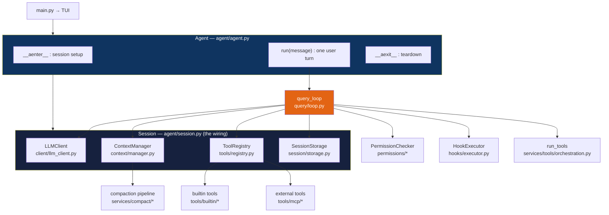
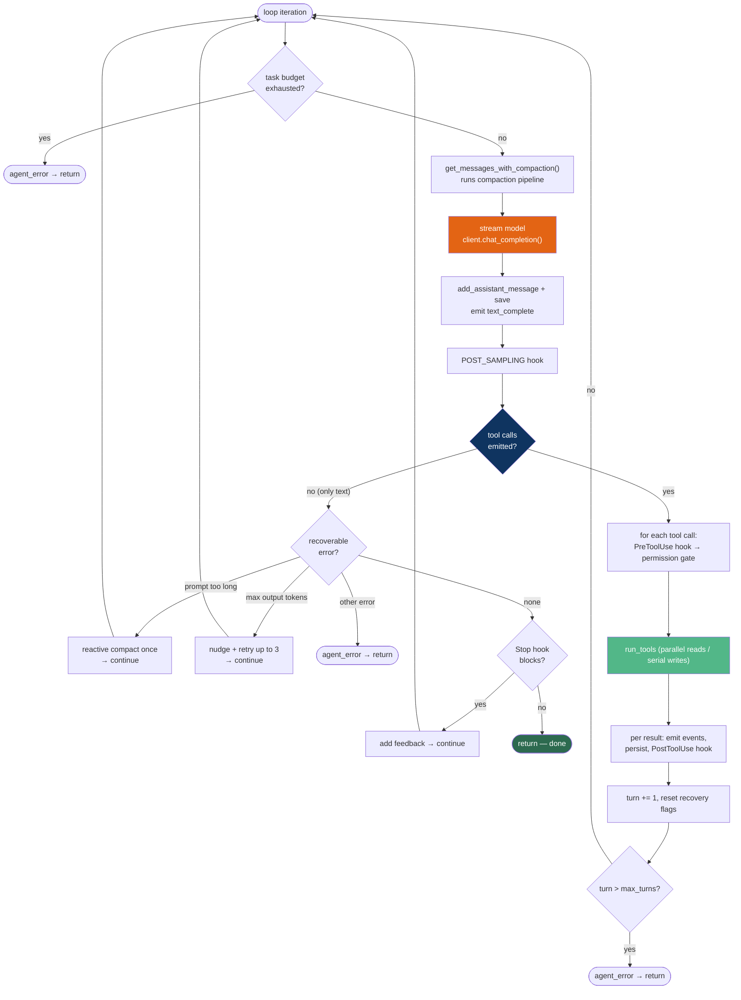
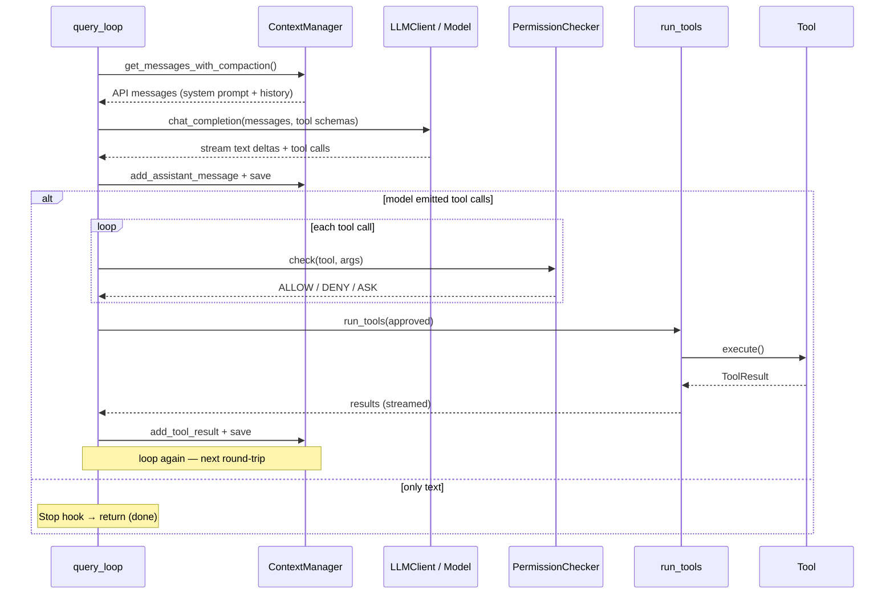
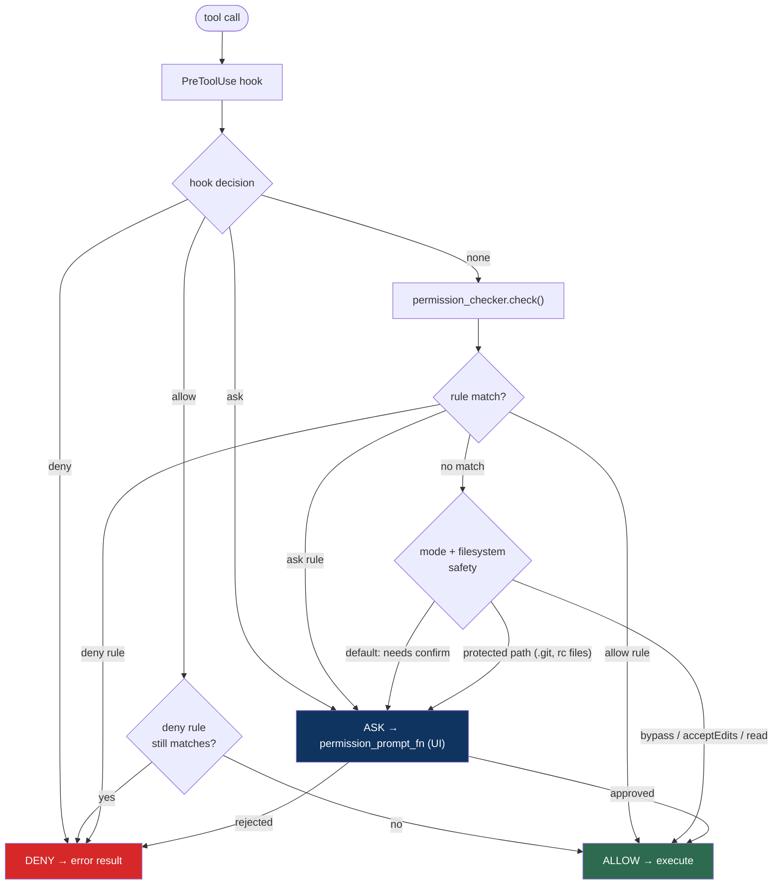
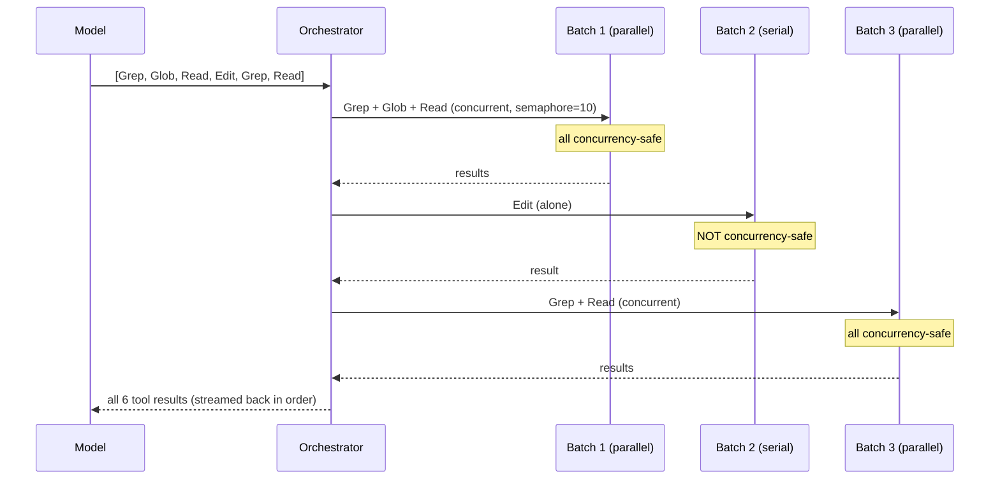

# Agent Architecture — Diagrams

A visual companion to the agentic spine. Read top to bottom: each diagram zooms
in one level. File:line references point at the live code.

> The one idea: the agent is a **loop of LLM round-trips**. Each round-trip the
> model either emits **tool calls** ("not done — run these and ask me again") or
> emits **only text** ("done"). Everything else hangs off that fork.
> See `query/loop.py:222` → `needs_follow_up = len(tool_calls) > 0`.

---

## 1. Component wiring — the spine and its spokes

`Agent` and `Session` are thin assembly points; the logic lives in `query_loop`.

---

## 2. Session lifecycle — the three phases

`__aenter__` and `__aexit__` run **once**; `run()` runs **per message**. Note
where the hooks fire.

```mermaid
sequenceDiagram
    participant U as User / UI
    participant A as Agent
    participant L as query_loop
    participant H as HookExecutor

    rect rgb(15,52,96)
    Note over A: __aenter__ (once)
    A->>A: load settings.json, permission rules
    A->>H: SessionStart hook
    A->>A: build context reminder (AGENT.md + date)
    end

    rect rgb(45,106,79)
    U->>A: message
    Note over A: run(message)
    A->>H: UserPromptSubmit hook
    A->>A: add_user_message + save to transcript
    A->>L: query_loop(...)
    L-->>U: stream AgentEvents (text, tool calls)
    L-->>A: loop ends
    end

    rect rgb(22,33,62)
    Note over A: __aexit__ (once)
    A->>H: SessionEnd hook
    A->>A: save metadata, close client + MCP
    end
```

---

## 3. The query loop — state machine (the heart)

One pass through this = one LLM round-trip plus its tool execution. This matches
`query/loop.py:109` onward exactly.

---

## 4. One round-trip — message flow

The concrete path of a single iteration across the collaborators. Two of these
back-to-back is "read a file, then edit it."

---

## 5. Compaction pipeline

Runs inside `get_messages_with_compaction()` before **every** API call
(`context/manager.py:220`). Order matters: cheap/lossless passes first, the
expensive LLM summary last. `reactive_compact` is a **separate emergency path**
the loop triggers only after the API rejects an over-long prompt.

```mermaid
flowchart LR
    IN["messages"] --> B["1. apply_tool_result_budget<br/>cap each result at 200K chars"]
    B --> S["2. snip_compact<br/>drop oldest groups (lossless)"]
    S --> MI["3. micro_compact<br/>NO-OP — see its docstring"]
    MI --> CO["4. context_collapse<br/>merge same-role + collapse old tool calls"]
    CO --> AC{over auto-compact<br/>threshold?}
    AC -->|yes| LLM["auto_compact<br/>LLM summary (expensive)"]
    AC -->|no| OUT["_build_api_messages()<br/>prepend system prompt + reminder"]
    LLM --> OUT

    API["API returns 413<br/>'prompt too long'"] -. triggers .-> RC["reactive_compact<br/>strip images + summarize, retry once"]
    RC -. retry .-> IN

    style MI fill:#6c757d,color:#fff
    style LLM fill:#f77f00,color:#fff
    style RC fill:#d62828,color:#fff
```

---

## 6. Permission decision

The gate every tool call passes before execution (`query/loop.py:341-424`,
`permissions/checker.py`). A PreToolUse hook can short-circuit; otherwise rules
(deny > allow > ask) then mode + filesystem safety decide.

---

## 7. Tool execution — parallel reads, serial writes

`partition_tool_calls` (`services/tools/orchestration.py:56`) groups consecutive
concurrency-safe (read-only) tools into one parallel batch; any write tool gets
its own serial batch. This is why the loop can fan out reads but never races two
writes.

---

## Where to go in the code

| Diagram | Primary file(s) |
|---|---|
| 1. Wiring | `agent/agent.py`, `agent/session.py` |
| 2. Lifecycle | `agent/agent.py` (`__aenter__`, `run`, `__aexit__`) |
| 3. Loop state machine | `query/loop.py` |
| 4. Round-trip flow | `query/loop.py`, `context/manager.py`, `client/llm_client.py` |
| 5. Compaction | `context/manager.py:220`, `services/compact/*` |
| 6. Permissions | `permissions/checker.py`, `core_types/permissions.py` |
| 7. Tool execution | `services/tools/orchestration.py` |
